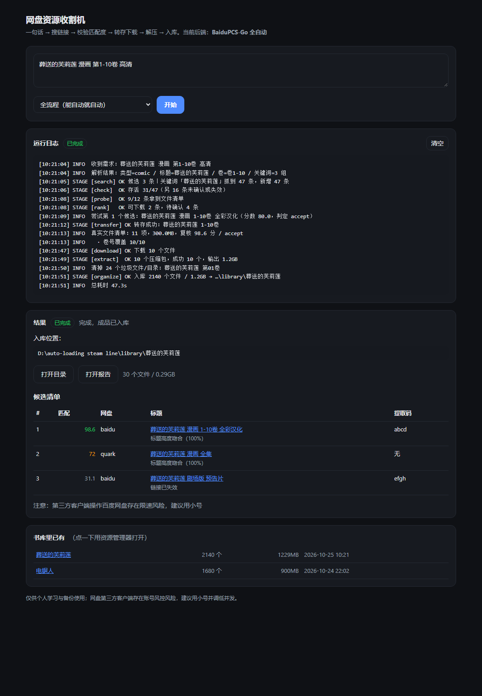

# 网盘资源收割机 · panharvest

**一句话进去，一本书出来。**

> 一次搜索能出来几十条网盘链接，你依然下不到东西 —— 缺的从来不是搜索，是**判断**。
> 所以本项目的核心不是"更多链接"，而是：**转存很便宜（不耗流量），那就先转存、看真实文件清单、重新打分，通过了才下载。**

```
"葬送的芙莉莲 漫画 第1-10卷 高清"
        │
        ├─ ① 理解   prompt → 片名 / 类型 / 卷号 / 3 组搜索词
        ├─ ② 搜索   PanSou 聚合 → 百度/夸克/阿里… 几十条分享链接
        ├─ ③ 验活   PanSou /api/check/links + 百度分享页深度探测
        ├─ ④ 判定   相关性打分 0-100 → accept / review / reject（附理由）
        ├─ ⑤ 转存   BaiduPCS-Go 转到「/资源收割/<任务名>」
        ├─ ⑥ 复核   ls 出真实文件清单，卷号/文件类型/体积对不上就换下一条
        ├─ ⑦ 下载   多线程下载到 data/downloads/
        ├─ ⑧ 解压   zip/7z/rar/tar + 密码字典 + 嵌套 + 分卷（AES zip 也支持）
        └─ ⑨ 入库   清广告、剥壳、去重 → library/<系列名>/，出报告 + 自动打开
```

没有现成开源项目能把这几段串起来——搜索用 [PanSou](https://github.com/fish2018/pansou)，
百度那一环用 [BaiduPCS-Go](https://github.com/qjfoidnh/BaiduPCS-Go)，
解压用 7-Zip / UnRAR，本项目负责**把这些粘成一条真正的流水线，并在每一步做判断**。



> 上图是本地界面的真实渲染（`start-ui.bat` 打开），数据是示例任务。

---

## 1. 5 分钟上手

前提：Windows / macOS / Linux，Python 3.10+（本机是 3.13，零第三方依赖）。

```powershell
# ① 装外部组件（7-Zip 控制台 + BaiduPCS-Go，走镜像自动下载，约 6MB）
harvest.bat setup

# ② 起一个 PanSou（搜索 + 链接检测服务，Docker 一行）
docker run -d --name pansou -p 8888:8888 ghcr.io/fish2018/pansou:latest

# ③ 开跑
harvest.bat "葬送的芙莉莲 漫画 第1-10卷 高清"
```

> macOS / Linux：把 `harvest.bat` 换成 `./harvest.sh`，把 `start-ui.bat` 换成 `./start-ui.sh`，其余命令完全一致。

想点按钮的话，双击 **`start-ui.bat`**，浏览器会打开 `http://127.0.0.1:8765/`：
一个输入框 + 实时日志 + 候选表，跑完直接出「打开目录 / 打开报告」。

**不装 BaiduPCS-Go 也能用**：程序会自动降级成「人工转存」模式，给你一个引导页
（每条链接 + 提取码 + 复制按钮），你转存下载后把文件丢进 `data/inbox/`，再执行
`harvest.bat resume <任务号>`，解压/清洗/入库/报告照样全自动。

---

## 2. 为什么要「转存后先复核再下载」

这一步是整个项目里最值钱的设计。

网盘分享的标题经常骗人（"全集"其实只有 3 卷、"1080P"其实是枪版、标题对但内容换成别的）。
只看标题就下载，等于把几十 GB 和几小时赌在一行字上。所以：

1. `transfer`（转存）很便宜 —— 几秒，不占流量，只占网盘空间；
2. 转存完立刻 `ls` 出**真实文件清单**；
3. 用真实清单重算分数：卷号覆盖率、扩展名分布、体积、文件数；
4. 判定为 `reject` → 删掉网盘临时副本，换下一个候选；通过才 `download`。

判定权重（满分 100）：

| 信号 | 分值 | 说明 |
|---|---|---|
| 标题相似度 | 45 | 与「标题/备注/原搜索词」分别比对取最高，避免拼串稀释 |
| 文件类型匹配 | 15 | 漫画期望 jpg/png/zip，书期望 pdf/epub，影视期望 mp4/mkv |
| 卷号覆盖 | 15 | 「要 1-10 卷」而资源里只有 1-3 卷 → 直接掉分 |
| 链接存活 | 15 | PanSou 检测：有效 / 需要提取码 / 已失效 |
| 体积与文件数 | 10 | 超过上限（默认 60GB / 5000 文件）判 reject |
| 负向词 | −30 | 预告、花絮、枪版、解说、广告… |
| 没有提取码 | −8 | 百度链接没提取码基本转存不了 |

`≥70` → 直接下；`45~70` → review（列出来但需要你确认）；`<45` → 丢弃。

---

## 3. 命令速查

| 命令 | 作用 |
|---|---|
| `harvest.bat "<一句话>"` | 完整流水线（默认 `--mode auto`） |
| `harvest.bat search "<一句话>"` | 只找链接，打印候选表 + 出报告，不下载 |
| `harvest.bat batch "<主题>" --queries "词1,词2,…"` | 主题批量扫描：多关键词并行预热 → 按书系分组出清单（`--download` 可直接下） |
| `harvest.bat quark-dl <夸克分享链接>` | 夸克全自动：转存 → 直链 → 断点下载（需要 `login --quark`） |
| `harvest.bat resume <任务号>` | 人工转存后：从 `data/inbox/` 取文件，继续解压入库 |
| `harvest.bat setup` | 下载 7-Zip 控制台（7zr + 7za）与 BaiduPCS-Go |
| `harvest.bat login --cookies "BDUSS=…; STOKEN=…"` | 登录百度（也可 `--bduss/--stoken`、`--show`、`--logout`） |
| `harvest.bat doctor` | 环境自检：PanSou 通不通、账号登没登、解压器齐不齐 |
| `harvest.bat selftest` | 37 项本地逻辑自检（不联网） |
| `harvest.bat serve` | 本地网页界面 |
| `harvest.bat extract <目录> --organize` | 只对某个目录解压 + 入库 |
| `harvest.bat library` / `jobs` | 看书库 / 看历史任务 |

`--mode search` 只看链接；`--mode inbox` 跳过搜索，直接处理 inbox。

---

## 4. 解压与清洗能力（本机实测通过）

| 格式 | 用什么 | 密码 | 备注 |
|---|---|---|---|
| `.zip` `.cbz` | Python 标准库 | ✔ | 自动修复 Windows 老包的 GBK 文件名乱码 |
| `.rar` `.cbr` | UnRAR.exe | ✔ | 分卷 `.part1.rar` 自动带上后续卷 |
| `.7z` `.001` | 7za.exe / 7zr.exe | ✔ | `setup` 自动装，无需安装 7-Zip |
| AES 加密 zip | 7za.exe | ✔ | python 解不了时自动回退到 7-Zip |
| `.tar/.gz/.bz2/.xz` | Python 标准库 | — | |
| 嵌套压缩包 | 递归 | ✔ | 最多 3 层（`extract.max_depth`） |

密码从哪儿来：提取码本身（最常见）→ 标题/备注里的「解压密码: xxx」→ 压缩包旁边的
`密码.txt` / `说明.txt` → `config.json` 里的常见密码表。
**一个包试出来的密码会记住并优先用于同批其它包**（网盘资源基本都是同一个密码）。

解压完还会：删广告 txt / `.url` / `__MACOSX` / `Thumbs.db` / 0 字节文件 → 剥掉多余的一层
壳目录 → 非法字符与超长名修正 → 同名同大小去重 → 搬进 `library/<系列名>/`。

---

## 5. 目录结构

```
panharvest/
├─ harvest.bat / harvest.sh   命令行入口（Windows / macOS·Linux）
├─ start-ui.bat / start-ui.sh 双击开网页界面
├─ config.example.json        配置样例（复制成 config.json 后改）
├─ panharvest/                全部源码（零第三方依赖）
│  ├─ intent.py               一句话 → 结构化需求
│  ├─ pansou.py               PanSou 搜索 + 链接存活检测
│  ├─ baidu.py                百度分享页深度探测
│  ├─ rank.py                 打分与判定
│  ├─ pcs.py                  BaiduPCS-Go 封装
│  ├─ extract.py              解压引擎
│  ├─ organize.py             清洗与入库
│  ├─ report.py               markdown 报告 / CSV / 引导页 / 索引页
│  ├─ pipeline.py             编排（可中断续跑）
│  ├─ topic.py                主题批量扫描与分组
│  ├─ quark.py                夸克分享免登录探测
│  ├─ quark_dl.py             夸克转存 → 直链 → 断点下载
│  ├─ state.py                SQLite 任务与候选记录
│  ├─ cli.py                  命令行入口
│  ├─ server.py               本地网页界面
│  └─ selftest.py             37 项自检
├─ tests/                     端到端测试（假 PanSou + 假 PCS）
├─ docs/ui-preview.png        界面截图
├─ .github/workflows/         CI：2 个系统 × 2 个 Python 跑自检
│
│  ── 以下是运行时目录，不进仓库（见 .gitignore）──
├─ tools/                     自动下载的外部组件（7zr / BaiduPCS-Go）
├─ data/
│  ├─ downloads/<任务>/       下载落点
│  ├─ inbox/                  人工转存模式：把文件丢这里
│  ├─ state.db                任务与候选记录（SQLite）
│  └─ baidupcs-config/        百度登录态（只在本机，绝不外传）
├─ library/<系列名>/          ← 成品，直接给阅读器扫这个目录
└─ reports/<任务>/            report.md / candidates.csv / handoff.html
```

---

## 6. 主要配置项

复制 `config.example.json` 成 `config.json` 后按需改，没改的走默认值。

| 键 | 默认 | 说明 |
|---|---|---|
| `pansou.base` | `http://127.0.0.1:8888` | PanSou 地址；开了认证再填 `pansou.token` |
| `limits.min_score` | `45` | 低于此分不自动下载 |
| `limits.max_total_gb` | `60` | 单个资源体积上限 |
| `limits.verify_top` | `12` | 最多深入探测多少条百度链接 |
| `baidupcs.remote_root` | `/资源收割` | 转存到网盘的哪个目录 |
| `baidupcs.max_files` / `threads` | `2` / `0` | **普通账号别调大**，容易被限速 |
| `baidupcs.keep_remote` | `true` | 下载后是否保留网盘副本 |
| `extract.passwords` | 一小组常见密码 | 追加你自己的常用密码 |
| `extract.delete_archives` | `false` | 解压后是否删除压缩包 |
| `organize.media_ext` | 图片/PDF/EPUB/视频… | 哪些扩展名算「内容」 |
| `backends.transfer` | `auto` | `auto` / `pcs`（强制自动）/ `manual`（只出链接） |
| `open_when_done` | `true` | 完成后自动打开书库目录 |

---

## 7. 验证状态（重要，别当成铁板钉钉）

已经**实测跑通**的：

- 37 项本地自检（`harvest.bat selftest`）：意图解析、卷号/季识别、打分判定、`ls` 表格解析、
  zip / GBK 文件名 / 嵌套压缩包 / tar.gz / rar / AES 加密 zip / 7z 的真实解压与密码回溯、
  清洗与入库；
- 端到端三用例（假 PanSou + 假 PCS + 真压缩包）：全自动流程、只搜链接、人工转存 +
  `resume` 续跑，全部通过；
- 网页界面：首页、提交任务、SSE 实时日志、结果渲染、书库接口；
- `harvest.bat` / `start-ui.bat` 在 cmd 下可正常调用；
- BaiduPCS-Go v4.0.2 的 `transfer` / `download` / `login` / `config` 参数与输出格式，
  是**对着真实程序和它的源码**核对的（包括「transfer 只能转存到当前工作目录」这种坑）。

**还没能用真实账号验证**的（代码路径完整，但需要你的 Cookie 才能跑）：

- `transfer` → `ls` → `download` 的真实闭环（没有百度账号，只用假 PCS 跑过）；
- 真实 PanSou 实例的返回（只用 mock 跑过；`/api/search` 与 `/api/check/links` 的字段
  是按官方 README 实现的，做了容错）；
- 百度分享页深度探测在**带提取码的活链接**上能否稳定拿到文件清单
  （实测：失效链接正确判死；需提取码的链接能识别出「需要提取码」，但拿不到清单
  ——所以判定主要靠标题 + 转存后的真实清单，这是有意为之的降级设计）。

第一次真机跑，建议：

```powershell
harvest.bat doctor                      # 先看环境
harvest.bat setup                       # 装组件
harvest.bat login --cookies "BDUSS=…; STOKEN=…"   # 用小号！
harvest.bat search "某个冷门但确定有的资源"        # 先只搜，不下载
```

---

## 8. 风险与限制

1. **账号风险**：第三方客户端操作百度网盘存在被限速/风控的可能。用小号，`max_files`
   保持 1-2，不要开高并发。原版 `iikira/BaiduPCS-Go` 仓库已删除，本项目默认指向社区维护的
   `qjfoidnh/BaiduPCS-Go`。
2. **搜索源靠不住**：PanSou 的数据来自 TG 频道和第三方站点，链接失效极快。程序会自动
   剔除失效链接并记录到 `data/state.db`，同一句话再跑一次不会重复踩坑。
3. **自动下载支持百度与夸克**：百度走 BaiduPCS-Go（`pcs.py`），夸克走 Cookie + 直链断点（`quark.py` 匿名探测清单、
   `quark_dl.py` 转存与下载）。阿里/115/UC 仍只参与搜索、打分并出现在候选表与报告里，自动下载需要它们的账号体系，暂未实现
   （它们仍会出现在 `handoff.html` 里供你手动取）。
4. **PanSou 是硬依赖**。没起 PanSou 就没得搜，`doctor` 会给启动命令。
5. **版权**：本工具只做"把公开分享链接变成本地文件"的自动化，内容合法性由使用者自行判断。

---

## 9. 排查手册

| 现象 | 原因 / 处理 |
|---|---|
| `连不上 PanSou` | 没起服务，或端口不是 8888。`docker run -d -p 8888:8888 ghcr.io/fish2018/pansou:latest`，然后 `harvest.bat doctor` |
| 一直提示「人工转存」 | BaiduPCS-Go 没装或没登录：`harvest.bat setup` → `harvest.bat login --show` |
| 转存失败 `errno 9019` / `-9` | 提取码错或链接失效；换个候选（报告里有一串） |
| 转存失败 `STOKEN` 相关 | Cookie 里缺 `STOKEN`，登录时带上它（必须在网盘页面复制） |
| 下载 0 KB/s | 普通账号被限速；把 `baidupcs.max_files` 调成 1，隔几小时再试 |
| 解压提示「需要安装 7-Zip」 | `harvest.bat setup`（会装 7zr + 7za，不用真的装软件） |
| 解压密码全错 | 把密码写进 `config.json → extract.passwords`，或放到下载目录的 `密码.txt` 里 |
| 文件名全是乱码 | 老 GBK 包由标准库路径处理；`rar/7z` 走外部程序，若乱码请装新版 7-Zip |
| 入库目录是空的 | 看报告里的 `extract` 阶段；多半是解压失败，日志会写原因 |

---

## 10. 二次开发

- **加网盘**：写一个 `transfer`/`download` 后端，`pipeline.Pipeline.backend()` 里选它；
  搜索侧只要产出的候选带 `cloud` 字段即可参与打分。
- **改打分**：`rank.judge()` 里六个信号加权，阈值走 `limits.min_score`。
- **加搜索源**：PanSou 本身支持插件；本项目只认 `/api/search` 的返回结构。
- **测试**：
  ```powershell
  harvest.bat selftest                  # 37 项纯本地自检
  python tests/test_e2e.py              # 端到端：假 PanSou + 假 PCS + 真压缩包（17 项）
  python tests/test_web.py 8902         # 网页界面：首页 / SSE / 结果（自带假 PanSou）
  python tests/dump_ui.py; node tests/test_ui.js   # 前端脚本渲染检查（需要 node）
  ```

---

MIT。仅供个人学习与资源备份使用。

---

## 11. 开源发布

| 文件 | 用途 |
|---|---|
| `docs/OPEN_SOURCE.md` | 发布前会诊：脱敏清单、仓库白名单、CI、元信息、路线图 |
| `docs/PROMO.md` | 全渠道文案：V2EX / 即刻 / 小红书 / 知乎 / 掘金 / B站 / Reddit / HN |
| `publish.py` | 走 GitHub REST API 发布（绕开本机不通的 git 协议），先 `--dry-run` |
